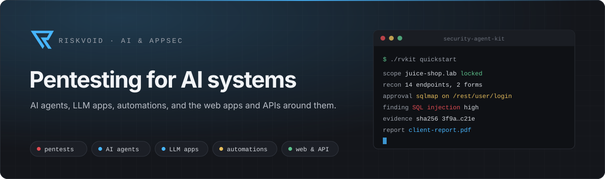

<p align="center">
  <a href="https://riskvoid.com"></a>
</p>

<p align="center">
  <a href="https://riskvoid.com"></a>
  <a href="https://github.com/RiskVoid/Security-Agent-Kit"></a>
  <a href="mailto:hello@riskvoid.com"></a>
</p>

RiskVoid is an AI and application security company. We pentest and review AI agents, LLM apps, workflow automations, and the web apps and APIs they run inside.

## What we do

| | |
|---|---|
| **Pentesting** | Hands on testing of web apps, APIs and AI features, with reproducible evidence and a report your engineers and auditors can both use |
| **AI agent and LLM security** | Prompt injection, tool abuse, data leakage, excessive agency and unsafe output handling, tested against your real agents and models |
| **Workflows and automations** | Security reviews of n8n and similar automations: credentials, webhooks, untrusted data flowing into actions |
| **Secure code review** | Source review of agent frameworks (LangGraph, LangChain, CrewAI) and the application code around them |

Need a test? Write to [hello@riskvoid.com](mailto:hello@riskvoid.com).

## Open source

### [Security Agent Kit](https://github.com/RiskVoid/Security-Agent-Kit)

The self-hosted AI security agent we use on engagements, open for anyone doing authorised work. It runs 45+ real security tools in a scoped Kali sandbox, asks before anything risky, keeps hashed evidence and writes the client report. Your data stays on your machine.

```bash
git clone https://github.com/RiskVoid/Security-Agent-Kit.git
cd Security-Agent-Kit
./rvkit setup
```

[Quick start](https://github.com/RiskVoid/Security-Agent-Kit#quick-start) · [What it can do](https://github.com/RiskVoid/Security-Agent-Kit#what-it-can-do) · [Contribute](https://github.com/RiskVoid/Security-Agent-Kit/issues)

### Also from us

- [n8n-nodes-riskvoid](https://github.com/RiskVoid/n8n-nodes-riskvoid): security checks as a node inside your n8n workflows
- [riskvoid-vscode](https://github.com/RiskVoid/riskvoid-vscode): issues and docs for the RiskVoid VS Code extension

---

<sub>Found a security issue in one of our projects? Email <a href="mailto:hello@riskvoid.com">hello@riskvoid.com</a> rather than opening a public issue. The Security Agent Kit is for systems you own or have written permission to test.</sub>
